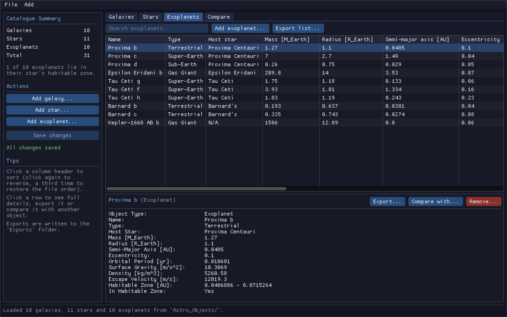

## This program is developed for PHYS30762 - Object-Oriented Programming in C++ at the University of Manchester.

A Star Catalogue is a program that allow user to store, view and calculate properties of astronomical objects through an interactive, user-friendly menu system. 

## === Features included: ===
- Load data from CSV files at startup
- Automatically calculating object specific properties:

  - GALAXIES: Absolute magnitude, and radial velocity.

  - STARS: Luminosity, Absolute Magnitude and Gravitational strength.

  - EXOPLANETS: Orbital Period, Surface Gravity, Density, Habitable Zone (approx.), and Escape Velocity.

- View catalogue summary showing number of objects per type and the total number
- Search for specific astronomical object or compare two of the same type
- View entire list of either galaxies, stars or exoplanets
- Export entire list or individual object's details as '.txt' or '.csv' to dedicated 'Exports' folder
- Sort in ascending/descending format by specific property of the object. Export sorted lists.
- Add object to the list
- Remove object from the list
- Save changes i.e. after addition or removal of objects.

## === Input files: ===
By default these files are inside the 'Astro_Objects' folder.
- 'galaxies.csv'
- 'stars.csv'
- 'exoplanets.csv'

Each file must contain valid data rows with comma separated values. 
This will be then read by the program accordingly.

## === Compilation: ===
Requires a C++17-compliant compiler. To compile with 'g++':

```bash
g++ -std=c++17 main_program.cpp galaxy.cpp celestial_objects.cpp export_galaxy_data.cpp star.cpp exoplanet.cpp export_exoplanet_data.cpp shared_functions.cpp export_star_data.cpp objects_loader.cpp add_object.cpp save_object.cpp sort_menu.cpp handle_sort_menu.cpp handle_export_menu.cpp -o astro_catalogue
```

Then to run the program: 
```bash
./astro_catalogue.exe
```

## === Graphical interface (Dear ImGui): ===
Alongside the terminal menu there is now a windowed version, `astro_catalogue_gui`, built with [Dear ImGui](https://github.com/ocornut/imgui) + GLFW + OpenGL 3.
It uses exactly the same classes, CSV files and export formats as the terminal program.



What it offers:
- Sidebar with the catalogue summary, quick "Add" buttons and a saved/unsaved indicator.
- One tab per object type with a searchable table showing all stored and calculated properties.
  Click a column header to sort (again to reverse, a third time to restore the file order). Sorting only changes the view, not the CSV files.
- Click a row to see the object's full details, export it (txt/csv), compare it with another object, or remove it.
- "Compare" tab: two objects of the same type side by side, with the ratio of each numeric property.
- "Export list..." exports the table exactly as shown (current sort and search filter) to the 'Exports' folder.
- Add-object forms with validation (the class constructors' error messages are shown in the dialog).
- Save with the button, File > Save or Ctrl+S. You are asked before quitting with unsaved changes.

### Building (both programs) with CMake
Requires CMake >= 3.16, a C++17 compiler and an internet connection the first time (Dear ImGui and GLFW are downloaded automatically).

```bash
cmake -S . -B build
cmake --build build --config Release
```

This produces `astro_catalogue` (terminal) and `astro_catalogue_gui` (window) in the project folder, next to 'Astro_Objects'.
On Windows they are `.exe` files; with MinGW add `-G "MinGW Makefiles"` to the first command.
On Linux you need the X11/OpenGL development packages, e.g. on Ubuntu:
`sudo apt install libgl1-mesa-dev libx11-dev libxrandr-dev libxinerama-dev libxcursor-dev libxi-dev`.
To build only the terminal version: `cmake -S . -B build -DASTRO_BUILD_GUI=OFF`.

The single `g++` command above still works for the terminal version.

## === Tips: ===
- Searching is case-sensitive, but if you make a mistake, the full list of available objects will be displayed so you can simply copy the desired name.
- Comparing two objects let you enter both names first and then in case of an error in either of objects you will see the error message and full list of available object will be displayed.
- To export the details of a single object, use the View/Export option. There, you can search for an object by name and export it to a file (case insensitive).
- Sorting by property is specific to the type of object, after sorting you can easily export data either as a full list or individual object.
- Adding an object is simple: choose the type of celestial object you want to add, then enter its properties one by one when prompted. Press Enter after typing each value.
- Removing an object is also case-sensitive, but the list of available objects will be displayed to simplify the process.
- If you make any changes (e.g. add or remove objects), make sure to save your changes. Otherwise, changes will only exist in temporary memory and will be lost when the program closes.
- When quitting, you’ll be asked whether to save changes, to prevent exiting without saving.

## === License === 
This project is for academic use. Not intended for redistribution.

## === Author ===
Rafal Dziewonski

## === Declaration ===
This project was developed with the assistance of AI tools.

Examples of usage include: explaining specific functions, assisting with memory management, clarifying program logic, and support in debugging tasks.

All final implementation decisions were made by the author, and AI assistance was used solely for support and clarification.

AI support was provided using ChatGPT and built-in Copilot in VS code.